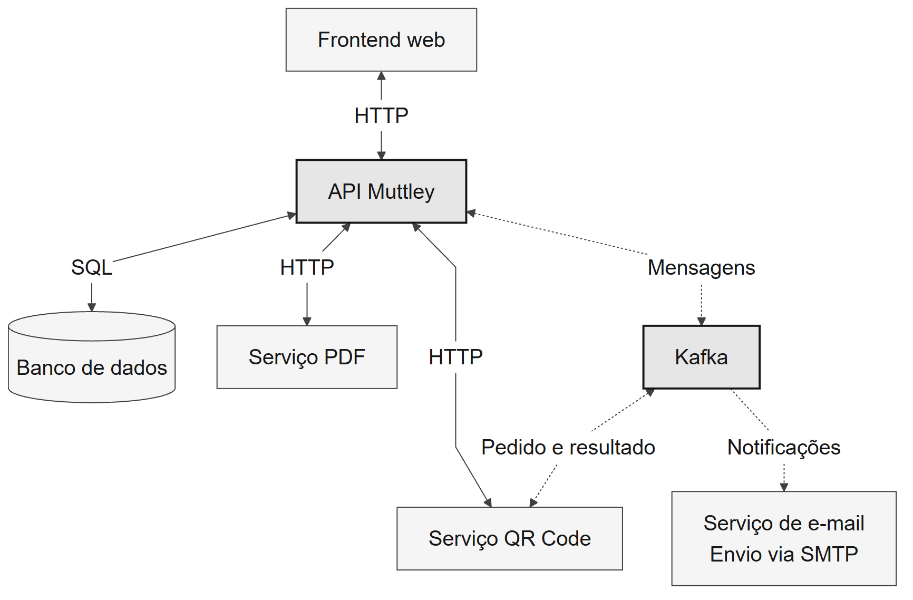

# Visão arquitetural simplificada

Versão compacta para inserir no TCC e em outros documentos:

- [PNG em alta resolução](visao-arquitetural-simplificada.png)
- [Fonte Mermaid editável](visao-arquitetural-simplificada.mmd)



**Legenda:** linhas contínuas representam comunicação síncrona; linhas tracejadas representam mensagens assíncronas. As setas duplas indicam comunicação nos dois sentidos. No Kafka, pedidos e resultados de QR Code circulam por tópicos distintos.

O QR Code mantém os caminhos HTTP e Kafka. O serviço PDF é acessado por HTTP; o serviço de e-mail consome notificações do Kafka e utiliza SMTP. Tecnologias internas, nomes dos tópicos, arquivos de assinatura e detalhes de implantação foram omitidos para favorecer a leitura. Consulte a [visão detalhada](../visao-arquitetural.mmd) para esses elementos.

Sugestão de identificação no TCC:

> Figura X – Visão arquitetural simplificada do Muttley
>
> Fonte: elaboração dos autores (2026).

Após instalar as dependências em `docs/diagramas`, regenere somente esta imagem:

```powershell
npm run render:documento
```

As opções de instalação e de navegador estão no [README dos diagramas](../README.md#gerar-novamente-os-pngs).
